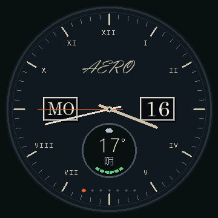
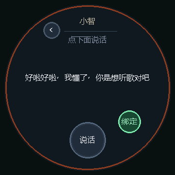

# RoundClock · ESP32-S3 圆形桌面终端

一块 **360×360 圆屏** 的桌面小终端。表盘、应用中心、十来个小应用，全部界面**自己画**——
不依赖 LVGL，直接往 RGB565 帧缓冲里写像素再推屏，所以整块屏的每一个弧线、每一圈刻度、
每一个像素的字距都是可控的。

| 模拟表盘 | 数字表盘 | 音乐 |
|---|---|---|
|  |  |  |

| 航班雷达 | 番茄钟 | 小智语音（连续对话中） |
|---|---|---|
|  |  |  |

> 截图来自真机帧缓冲回读（`SHOT` 命令 → USB-CDC 传回 → PNG），不是设计稿。

---

## 硬件

| 项 | 规格 |
|---|---|
| 主控 | ESP32-S3 · 8 MB PSRAM(OPI) · 16 MB Flash |
| 屏幕 | 1.85" 360×360 **ST77916**，QSPI（SCK40 / D0-46 / D1-45 / D2-42 / D3-41 / CS21 / RST3 / BL5） |
| 触摸 | **CST816S**（0x15，SDA11 / SCL10 / INT4） |
| 音频 | **ES8311** 播放 codec（0x18）+ **ES7210** 麦克风 ADC（0x40）+ I2S（MCLK2 / BCK48 / LRCK38 / DOUT47 / DIN39）+ PA_EN=GPIO9 |
| 时钟 | **PCF85063** RTC（0x51）+ 备份电池 |
| 电量 | **BQ27220** 电量计（0x55） |
| 存储 | microSD（SD_MMC 4-bit：15/14/16/17/12/13） |
| 按键 | 仅 BOOT=GPIO0 可用（PWR 为硬件锁存，读不到） |

整机是"演示性优先"的设备：屏幕永远有内容、字号大、按键好按。

---

## 交互模型

三层，没有全局返回键：

```
   表盘  ←──────→  应用中心  ←──────→  某个应用
   ↑                                        │
   └──────────── 任意应用上滑 = 回表盘 ─────┘
```

- **表盘**是一块页两种脸：模拟 / 数字。**点轴心（r ≤ 34）或上滑换脸**，左右滑进应用中心。
- **应用中心**是 10 格正三角形（1+2+3+4）：设置坐顶点，往下两格三格四格。预留位画虚线环，
  点一下只提示「待扩充」。
- 任意应用内**上滑回表盘**，其余方向回应用中心。
- **任意页上半屏下拉**呼出设置（亮度 / 音量 / Wi-Fi）。
- 只有**表盘**响应下拉；两个列表态（曲库浮层、Wi-Fi 扫描）把上下滑留给列表本身。
- 触摸全部自己做：100 Hz 读 CST816S 原始寄存器，抬手时算位移——
  **≥26 px 判滑动 / ≤18 px 且 ≤600 ms 判点击**。功能键一律 `fillCircle`，圆角矩形会和屏幕弧线打架。

---

## 功能

**① 表盘** — 模拟版是罗马刻度 + 三针 + AERO 花体标识，日期/星期用两个**立体倒角窗**（仿 Lange Datograph
布局），窗口字体是单独生成的 4-bit AA 字库；数字版是 AA 大数字 + 外圈橙弧走秒 + 天气块。
底部副盘是弧形电量，6 格沿弧排布。

**② 音乐** — 三个音源共用一套播放器：**网络电台**（12 条 MP3 直链）、**TF 卡本地文件**（递归两层、上限
20 首）、**播客 RSS**（解析 `<enclosure>`，自动剥掉 podtrac / spotify 之类跟踪跳转）。曲库浮层支持分页。

**③ 航班雷达** — 极坐标雷达 + 扫描扇区，数据来自 [adsb.lol](https://adsb.lol) 免密钥公开 API
（250 nm 内真实目标）。呼号标签自动避让，右侧放不下就翻到左侧。N/E/S/W 与标题都垫同背景底片，
扫描线扫过不会穿字。

**④ 小智语音** — 真正的 [xiaozhi-esp32](https://github.com/78/xiaozhi-esp32) 协议，
不是自己拼的：**16 kHz 上行 Opus / 24 kHz 下行 Opus**，双向 WebSocket + 文本帧 JSON。
说完自动断句、服务器回 STT 文本、TTS 音频边收边播，**播完自动接着听**——连续对话不用按键。
再点一下是插话。

**⑤ 录音机** — 首先是录音机：`/REC/RECxxxx.WAV`，16 kHz / 16 bit / 单声道，单段 60 秒上限。
录完直接回放；「纪要」是可选的附加动作，把 WAV 交给云端转写并整理成文字。

**⑥ 番茄钟** — 15/25/45 三档。**外圈整条环就是倒计时**：满格起步、顺时针缩短到归零。四轮后自动长休息。

**⑦ 待办 / 备忘** — 说一句「明天下午三点开会」就能落一条待办，按本地日期排序，到期高亮。

**⑧ 背单词 / 电子宠物** — 单词卡按词书分批，宠物按专注时长成长。

**⑨ Wi-Fi 配网** — 完全在设备上完成：扫周边 → 点 SSID → 屏上 QWERTY 输入 → 写 NVS 重启。
不需要手机或电脑。密码簿记住最近 5 组。

**⑩ 设置** — 亮度 10–100、音量 0–21、Wi-Fi 入口、城市选择、表盘换脸。配置存 NVS，重启保留。

**锁屏** — BOOT 键开关。息屏后触摸全部忽略，避免口袋里误触。

---

## 快速开始

需要 **Arduino IDE 的 arduino-cli** + **esp32 core 3.0.7**（IDF 5.1）。
更高版本未验证，更低版本缺 `ledcAttach` / `quad_mode`。

```bash
cd firmware
build.bat            # 编译
flash.bat COM3       # 烧录（端口改成你的）
```

FQBN：

```
esp32:esp32:esp32s3:FlashSize=16M,PSRAM=opi,CDCOnBoot=cdc,CPUFreq=240,\
UploadSpeed=921600,PartitionScheme=app5M_fat7M_16MB
```

`app5M_fat7M_16MB` 是本工程用的分区（自定义分区文件在 `firmware/partitions/`）。**因为塞进了 Opus 编解码器，
app 分区必须 ≥ 4 MB**，旧的 `app3M_fat9M` 装不下。

**首次配网**：设置页首行 `WIFI` → 选 SSID → 输入密码 → `JOIN`。
彩云天气 token 可留空（会自动走免密钥的 Open-Meteo / MET Norway）。

**第三方库要打两个补丁**（顺序不能反）：

```sh
patch -p1 < firmware/patches/ESP32-audioI2S-3.4.0-roundclock.patch
patch -p1 < firmware/patches/ESP32-audioI2S-3.4.0-fullduplex.patch
```

第一个修 `zeroI2Sbuff()` 里破坏 GDMA 回收的 preload（不修会播放 0.3 秒后永久静音）；
第二个开 I²S 全双工并导出 RX/TX 句柄（小智和录音机都要用它直接读写 DMA）。

**Opus 源码已经 vendor 进来了**（`firmware/src/opus`，libopus 1.3.1 定点版裁剪），
Arduino 会递归编译 `src/`，不用额外装库。重新生成方式见
[`firmware/src/opus/README-LICENSE.txt`](firmware/src/opus/README-LICENSE.txt)。

---

## 架构要点

### 自绘帧缓冲，不用 LVGL

LVGL 在 360×360 圆屏上要额外处理圆形裁剪、自定义控件、字体子集，反而不如直接画。
整屏是一块 PSRAM 里的 `uint16_t[360*360]`（259 KB），所有图元都作用在它上面，最后整块推给 QSPI 屏。

字库全部是**离线生成的位图**：

- `FONT12 / FONT16 / FONT24` — 1-bit 点阵。FONT16 是 GB2312 全表，FONT24 只有约 170 字的小字表
- `font_aero.h` — 花体标识（88×22 4-bit AA）
- `font_dial.h` — 表盘窗字体（Century Schoolbook Bold 风格，4-bit AA，字母横向压缩 12%）
- `FONT_BIG_AA` — 44×64 4-bit AA 大数字

生成器在 `firmware/tools/`（PIL + 系统 TTF，改参数重新生成即可）。

### 音频、网络、触摸都是独立任务

`ESP32-audioI2S` 的 `loop()` 一旦放主循环，一点播放整屏就卡死。现在：

| 任务 | 核 | 优先级 | 干什么 |
|---|---|---|---|
| `audioTask` | 0 | 1 | `Audio` 对象的 `new` / `loop()`，三音源共用命令队列 |
| `netTask` | 1 | 1 | 所有 HTTPS：天气、雷达、百炼、绑定、Qwen |
| `xzchat` | 1 | 2 | 小智会话：WS 收包 + Opus 编解码 + 边收边播 |
| `micTask` | 1 | 2 | 100 Hz 采音，3 点均值降采样 48k → 16k |
| `touchTask` | 1 | 3 | 100 Hz 读触摸 |
| 主循环 | 1 | — | 只做绘制、手势分发、串口命令 |

### I²S 是全双工共享的

ES8311（播放）和 ES7210（录音）挂在同一组 BCLK/LRCK 上，所以**采样率被播放侧锁死在 48 kHz**。
录音时按 48k 收、3 点降采样到 16k；小智下行 24k 则线插值上采样回 48k。
**TX/RX 都是 16 bit 立体声**，写单声道会让音调掉八度——必须左右各写一份。

### I²C 总线必须加锁

触摸任务跑 100 Hz，主循环同时在读 RTC、电量计、codec —— Arduino 的 `Wire` **不是线程安全的**。
`I2C_Lock() / I2C_Unlock()` 把四类从设备全部串行化。

### 内存是硬约束，不是优化项

8 MB PSRAM 很宽裕，但**内部 RAM 只有 512 KB，减掉 Wi-Fi/BT 协议栈后能用的不到 150 KB**。
小智会话要同时占：TLS 两块 16 KB 连续堆 + ES7210 RX 的 DMA 环 + 帧缓冲之外的绘制缓冲。
一开始三张曲库表（3×40×448 B = 52.5 KB）在 `.bss` 里，一开语音就把内部 RAM 挤爆，
LCD 直接 `spi transmit (queue) color failed` 卡屏。现在它们改 `ps_malloc` 上 PSRAM，
**内部静态内存 131 KB → 77 KB**，会话中仍有 80 KB 余量。

---

## 踩过的坑（都写在 `firmware/README.md` 里）

这个项目真正的成本在排障，挑几个：

- **`i2s_channel_preload_data(2 字节)` 会破坏 IDF 5.1 的 GDMA 回收** —— 表现是播放 0.3 秒后
  永久静音，40~57 KB 之后每次 `i2s_channel_write` 都 TIMEOUT。删掉 preload 就好了。
- **Wi-Fi 每 15 秒重连一次会打断 4-way handshake** —— 设备永远卡在 `204 HANDSHAKE_TIMEOUT`，
  看起来像密码错。改成 30 秒 + 彻底重置 STA 才通。
- **任务栈放 PSRAM 会随机重启** —— 只要任务里碰 NVS / flash（`Preferences`、`nvs_get_*`、OTA 分区读），
  就会在 `spi_flash_disable_interrupts_caches` 里断言 `esp_task_stack_is_sane_cache_disabled`。
  解法是**会话开始前把配置在主循环里预缓存好**，任务里一个字节的 flash 都不读。
- **mbedtls 要两块 16 KB 的连续内部堆** —— 开机时天气/ADSB 的 TLS 还没退，小智握手就报
  `SSL - Memory allocation failed`。加 4 次带退避的重试。
- **1-bit 点阵字库中英混排必然重叠** —— ASCII 字形画布 16 px 但步进只有 10 px，中文满 16 px，
  数字后面直接撞进汉字格子。数字和中文必须分段画。
- **`roundRect()` 的四角弧角度错一个象限，弧线会斜穿进胶囊内部** —— 实机上像四个角被啃掉。
- **RTC 寄存器偏移不能照抄手册** —— 这颗 PCF85063 实测是 `0x04=秒 / 0x05=分 / 0x06=时 / 0x07=日 /
  0x08=星期 / 0x09=月 / 0x0A=年`，写手册地址会落进 RAM 区、不走时。
- **ESP32-S3 只有 BLE，没有经典蓝牙** —— 蓝牙耳机 / A2DP 做不到，别在这上面花时间。

更多见 [`firmware/README.md`](firmware/README.md)（版本演进 + 逐条排障记录）和
[`DESIGN.md`](DESIGN.md)（数据源选型与论证）。

---

## 目录

```
firmware/
  main.cpp            界面 / 页面状态机 / 手势 / 串口命令
  gfx.cpp .h          图元（圆、弧、圆角矩形、AA 文字、表盘窗、立体倒角）
  audio_player.h      三音源播放器 + 看护状态机 + I2S 直写 PCM
  mic_recorder.h      ES7210 采音（一次性录音 / 流式两用）
  recorder.h          TF 卡 WAV 录音机
  xiaozhi_client.h    小智 WebSocket 会话（Opus 双向 + 连续对话）
  xiaozhi_binding.h   设备绑定（OTA 接口 + eFuse HMAC）
  ai_cloud.h          百炼 ASR / Qwen / 待办提取 / 凭据
  secure_http.h       受限长度 HTTPS 响应读取 + 系统 CA 库
  Display_ST77916.*   QSPI 屏驱动
  Touch_CST816.*      触摸驱动
  es8311.* / es7210.* 播放 codec / 麦克风 ADC
  I2C_Driver.*        总线互斥
  provision.h         配网（AP + 网页 / 屏上键盘）
  runtime_config.h    NVS 配置 + 串口命令
  config.h            编译期默认值（Wi-Fi / token / 百炼 key 均留空）
  font_*.h            位图字库
  src/opus/           vendored libopus 1.3.1 定点版（编 + 解）
  tools/              字库生成器、抓帧、串口探针、离线预览、opus vendor 脚本
  patches/            第三方库补丁（顺序：roundclock → fullduplex）
docs/screenshots/     真机截图
round-clock-prototype.html   早期 HTML 原型（交互式设计稿）
```

---

## 串口命令

插上 USB-CDC 即可，115200，一行一条：

```
STATUS / MEM / SHOT        系统状态 / 堆分布 / 回传整帧
PAGE n                     直接跳页（调试用）
BAILIAN <key>              存百炼 API Key 到 NVS
QWEN <文本>                纯文本问答（不走语音）
XZCHAT / XZCLOSE / XZINFO  开 / 关 / 查小智会话
XZBIND                     触发设备绑定
MICTEST <秒>               采音自测，报样本数 / peak / rms
RECREC <秒> / RECPLAY      录音自测 / 回放第一段
AUD / SRC n / PLAY / STOP  音频状态 / 切音源 / 播 / 停
WIFI <ssid> <pass>         配网
```

`tools/serial_probe.py` 支持 `WAIT:n` 延时，一条连接发一串命令——
反复开关串口会触发 USB-CDC 复位，这是必踩的坑。

---

## 已知限制

- Wi-Fi 只能 **2.4 GHz**。
- 蓝牙耳机不可用（ESP32-S3 只有 BLE，无经典蓝牙 A2DP）。
- 无 OTA，只能 USB 烧录。
- 播客只取 RSS 前若干集的第一个 enclosure，不支持分集分页。
- 界面文字仅中文 + ASCII（字库是按需生成的子集，FONT24 缺字不报错、直接画空白）。
- 小智的语音识别效果依赖网络与环境噪声，安静环境下更稳；嘈杂环境需要调 VAD 阈值。
- 云端功能（百炼 ASR / Qwen、小智）都需要自备 API Key 与网络，仓库里不含任何密钥。

---

## License

MIT，见 [LICENSE](LICENSE)。

第三方组件版权归各自作者：`ESP32-audioI2S`（MIT）、`libopus`（BSD 3-Clause，
见 `firmware/src/opus/README-LICENSE.txt`）、乐鑫 `esp_lcd_st77916` 参考实现等。
航班数据来自 adsb.lol，天气数据来自彩云 / Open-Meteo / MET Norway，
电台与播客流版权归各电台与制作方。
