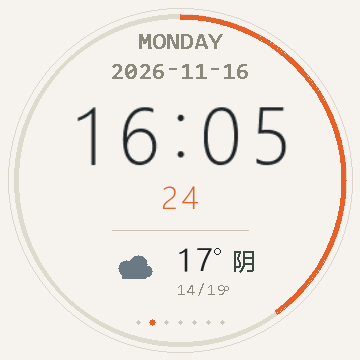
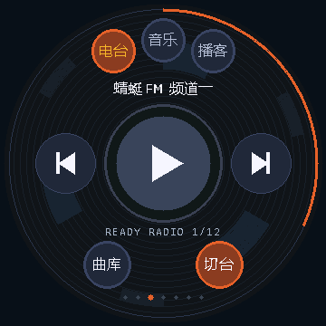
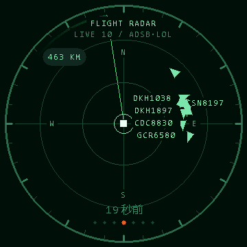
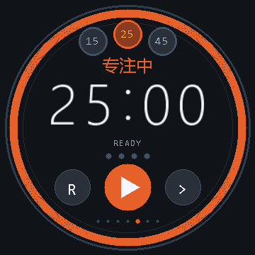

# RoundClock · ESP32-S3 圆形桌面终端

一块 **360×360 圆屏** 的桌面小终端，七页可翻：机械表盘、电子钟、音乐播放、航班雷达、番茄钟、Wi-Fi 配网、设置。
全部界面**自己画**——不依赖 LVGL，直接往 RGB565 帧缓冲里写像素再推屏，所以整块屏的每一个弧线、每一圈刻度、
每一个像素的字距都是可控的。

| 机械表盘 | 电子钟 | 音乐 | 航班雷达 | 番茄钟 |
|---|---|---|---|---|
|  |  |  |  |  |

> 截图来自真机帧缓冲回读（`SHOT` 命令 → USB-CDC 传回 → PNG），不是设计稿。

---

## 硬件

| 项 | 规格 |
|---|---|
| 主控 | ESP32-S3 · 8 MB PSRAM(OPI) · 16 MB Flash |
| 屏幕 | 1.85" 360×360 **ST77916**，QSPI（SCK40 / D0-46 / D1-45 / D2-42 / D3-41 / CS21 / RST3 / BL5） |
| 触摸 | **CST816S**（0x15，SDA11 / SCL10 / INT4） |
| 音频 | **ES8311** codec（0x18）+ I2S（MCLK2 / BCK48 / LRCK38 / DOUT47 / DIN39）+ PA_EN=GPIO9 |
| 时钟 | **PCF85063** RTC（0x51） |
| 电量 | **BQ27220** 电量计（0x55） |
| 存储 | microSD（SD_MMC 4-bit：15/14/16/17/12/13） |
| 按键 | 仅 BOOT=GPIO0 可用（PWR 为硬件锁存，读不到） |

整机可视为一个"演示性优先"的设备：屏幕永远有内容、字号大、按键好按。

---

## 功能

**① 机械表盘** — 罗马刻度 + 三针 + AERO 花体标识，底部副盘显示天气与弧形电量。
日期/星期用两个**立体倒角窗**（仿 Lange Datograph 布局），窗口字体是单独生成的 4-bit AA 字库。

**② 电子钟** — 4-bit AA 大字号时间，外圈一圈 60 秒进度弧，下方天气区（图标 / 温度 / 描述 / 高低温）。
点天气区立刻重拉真实数据。

**③ 音乐** — 三个音源共用一套播放器：**网络电台**（12 条 MP3 直链）、**TF 卡本地文件**（递归两层、上限 20 首）、
**播客 RSS**（解析 `<enclosure>`，自动剥掉跟踪跳转链）。曲库浮层支持分页；播放中唱片标签会转。

**④ 航班雷达** — 极坐标雷达 + 扫描扇区，数据来自 [adsb.lol](https://adsb.lol) 免密钥公开 API（250 nm 内真实目标）。
呼号标签会自动避让、右侧放不下就翻到左侧；点飞机看详情卡。方位字母 N/E/S/W 与标题都垫同背景底片，
扫描线扫过不会穿字。

**⑤ 番茄钟** — 15/25/45 分钟三档。**外圈整条环就是倒计时**：满格起步、顺时针缩短到归零。
四轮后自动长休息，轮次用底部小圆点记。

**⑥ Wi-Fi 配网** — 完全在设备上完成：扫周边 → 点 SSID → 屏上 QWERTY 输入 → 写 NVS 重启。不需要手机或电脑。
密码簿记住最近 5 组，下次同 SSID 自动填充。

**⑦ 设置** — 任意页**上半屏下拉**呼出：亮度 10–100、音量 0–21、Wi-Fi 入口。配置存 NVS，重启保留。

**锁屏** — BOOT 键开关。息屏后触摸全部忽略，避免口袋里误触。

---

## 快速开始

需要 **Arduino IDE 的 arduino-cli** + **esp32 core 3.0.7**（IDF 5.1）。
更高版本未验证，更低版本缺 `ledcAttach` / `quad_mode`。

```bash
cd firmware
build.bat            # 编译
flash.bat COM3       # 烧录（端口改成你的）
```

FQBN：

```
esp32:esp32:esp32s3:FlashSize=16M,PSRAM=opi,CDCOnBoot=cdc,CPUFreq=240,\
UploadSpeed=921600,PartitionScheme=app3M_fat9M_16MB
```

**首次配网**：开机后点左上角 Wi-Fi 图标 → 选 SSID → 输入密码 → `JOIN`。
彩云天气 token 可留空（会自动走免密钥的 Open-Meteo / MET Norway）。

**音频库需要打补丁**：`firmware/patches/ESP32-audioI2S-3.4.0-roundclock.patch`
（不加会播放 0.3 秒后永久静音，根因见下方"踩过的坑"）。

---

## 架构要点

### 自绘帧缓冲，不用 LVGL

LVGL 在 360×360 圆屏上要额外处理圆形裁剪、自定义控件、字体子集，反而不如直接画。
整屏是一块 PSRAM 里的 `uint16_t[360*360]`（259 KB），所有图元都作用在它上面，最后整块推给 QSPI 屏。

字库全部是**离线生成的位图**：

- `FONT12 / FONT16 / FONT24` — 1-bit 点阵，ASCII + 111 个常用汉字
- `font_aero.h` — 花体标识（88×22 4-bit AA）
- `font_dial.h` — 表盘窗字体（Century Schoolbook Bold 风格，4-bit AA，字母横向压缩 12%）
- `FONT_BIG_AA` — 44×64 4-bit AA 大数字

生成器在 `firmware/tools/`（PIL + Windows TTF，改参数重新生成即可）。

### 音频必须独立任务

`ESP32-audioI2S` 的 `loop()` 一旦放主循环，一点播放整屏就卡死。现在 `audioTask` 跑在 Core0，
优先级低于库内解码；网络请求单独一个 `netTask` 在 Core1。三音源（电台/TF/播客）共用一条命令队列，
避免状态机互相踩。

### I²C 总线必须加锁

触摸任务跑 100 Hz，主循环同时在读 RTC、电量计、codec —— Arduino 的 `Wire` **不是线程安全的**，
互相插队会读到错乱数据。`I2C_Lock() / I2C_Unlock()` 把四类从设备全部串行化。

### 触摸手势自己做

CST816S 只报点和滑动方向，不够用。现在 100 Hz 读原始寄存器，抬手时算位移：
**≥26 px 判滑动 / ≤18 px 且 ≤600 ms 判点击**。主页十字翻页、子页环形翻页都由这套手势驱动。

---

## 踩过的坑（都写在 `firmware/README.md` 里）

这个项目真正的成本在排障，几个典型：

- **`i2s_channel_preload_data(2 字节)` 会破坏 IDF 5.1 的 GDMA 回收** —— 表现是播放 0.3 秒后
  永久静音，40~57 KB 之后每次 `i2s_channel_write` 都 TIMEOUT。删掉 preload 就好了。
- **Wi-Fi 每 15 秒重连一次会打断 4-way handshake** —— 设备永远卡在 `204 HANDSHAKE_TIMEOUT`，
  看起来像密码错。改成 30 秒 + 彻底重置 STA 才通。
- **`esp_wifi_scan_start()` 在 STA 正在连接时返回 `ESP_ERR_WIFI_STATE`** —— 扫描前必须关射频重开、等 IDLE。
- **1-bit 点阵字库中英混排必然重叠** —— ASCII 字形画布 16 px 但步进只有 10 px，中文满 16 px，
  数字后面直接撞进汉字格子。数字和中文必须分段画。
- **表盘双窗"不平衡"的真因是宽度不是字高** —— 两个字母的墨迹宽度是字高的 2.4 倍，
  再怎么调字号都失衡。最后靠字母横向压缩 12% + 数字等宽槽才对齐。
- **圆屏里的功能键一律用 `fillCircle`** —— 圆角矩形的四个角会跟屏幕弧线打架。
- **RTC 寄存器偏移不能照抄手册** —— 这颗 PCF85063 实测是 `0x04=秒 / 0x05=分 / 0x06=时 / 0x07=日 /
  0x08=星期 / 0x09=月 / 0x0A=年`，写手册地址会落进 RAM 区、不走时。

更多见 [`firmware/README.md`](firmware/README.md)（版本演进 + 逐条排障记录）和
[`DESIGN.md`](DESIGN.md)（数据源选型与论证）。

---

## 目录

```
firmware/
  main.cpp            界面 / 页面状态机 / 手势 / 串口命令
  gfx.cpp .h          图元（圆、弧、圆角矩形、AA 文字、表盘窗、立体倒角）
  audio_player.h      三音源播放器 + 看护状态机
  Display_ST77916.*   QSPI 屏驱动
  Touch_CST816.*      触摸驱动
  es8311.*            codec
  I2C_Driver.*        总线互斥
  provision.h         配网（AP + 网页 / 屏上键盘）
  runtime_config.h    NVS 配置 + 串口命令
  config.h            编译期默认值（Wi-Fi / token 均留空）
  font_*.h            位图字库
  tools/              字库生成器、抓帧、串口探针、离线预览
  patches/            第三方库补丁
  README.md           详细开发日志
docs/screenshots/     真机截图
round-clock-prototype.html   早期 HTML 原型（交互式设计稿）
```

---

## 已知限制

- 音频只在**单声道 44.1 kHz** 下验证；蓝牙耳机不可用（ESP32-S3 只有 BLE，无经典蓝牙 A2DP）。
- 播客只取 RSS 前若干集的第一个 enclosure，不支持分集分页。
- Wi-Fi 只能 2.4 GHz。
- 无 OTA，只能 USB 烧录。
- 界面文字仅中文 + ASCII（字库是按需生成的子集）。

---

## License

MIT，见 [LICENSE](LICENSE)。

第三方组件版权归各自作者：`ESP32-audioI2S`（MIT）、乐鑫 `esp_lcd_st77916` 参考实现等。
航班数据来自 adsb.lol，天气数据来自彩云 / Open-Meteo / MET Norway，电台与播客流版权归各电台与制作方。
