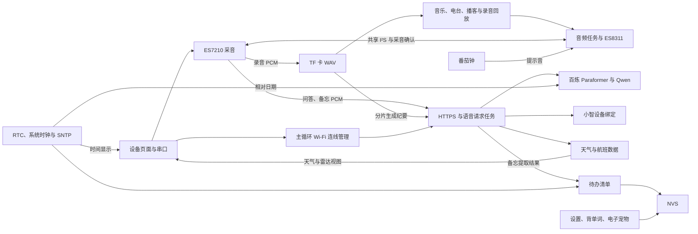

# RoundClock v2.6.2 模块关系

| 关联 | 之前的问题 | v2.6.2 的处理 |
| --- | --- | --- |
| 录音机 → TF 卡 → 回放与纪要 | 显示列表上限也影响编号。保存大文件会长时间占住主循环。 | 全目录计算编号，显示窗口保留最新 24 段。逐块写临时文件，写完才改名。卡上有活动读写时，重扫描保留现有挂载。 |
| 播放 ↔ 麦克风 | 播放停止命令异步执行，采音可能赶在播放停止前启动。 | 音频任务确认停播后才开启 RX。采音期间，新的播放命令返回繁忙日志。 |
| 采音或 WAV → 百炼 → 页面 | 问答复制 PCM，纪要整段载入 PSRAM。识别中的操作缺少取消入口。 | 问答与备忘转移采音缓冲的所有权。纪要每次读取 100 ms 的 PCM。网络超时或取消时释放缓冲和文件。 |
| Wi-Fi → 云端模块 | 长语音占用任务时，重连和小智绑定轮询也被排在后面。 | 重连由主循环推进。HTTPS 任务按绑定、语音和后台数据优先级运行。已经发出的请求按自身超时结束，正在绑定时排队的语音可以取消。 |
| RTC/SNTP → 待办、表盘、Qwen | 设备页面与待办的计时路径不同。用剩余秒数算天数会跨午夜误标。 | 恢复 RTC 和手动校时同步设置系统时钟。到期按本地日期计算。待办单次提交并兼容旧条目，保存失败时重新载入原数据。 |
| 云端响应 → UI | 未声明长度的上游响应会持续累积。串口 SHOW 明文显示彩云 Token。 | Qwen、绑定和天气按响应字节设上限。彩云 Token 只打印配置状态。 |
| 页面 → LCD | 应用中心和设置页定时全屏重绘。 | 两页使用事件刷新，设置页额外跟随 Wi-Fi 状态变化。动画和语音进度页维持定时刷新。 |

## 实机验收重点

- 用一张带 25 段以上录音的 TF 卡再录一段，确认旧录音大小和内容保持一致。使用慢速或接近容量上限的 TF 卡检查保存失败提示。
- 播放电台或回放时切到备忘，确认开麦前停播。
- 生成一分钟录音纪要时切断 Wi-Fi，再恢复连接，观察取消、重连和再次识别。查看 `MEM` 的内部堆和最大块。
- 断网重启，核对 `STATUS` 的时间来源。用跨午夜的到期时间核对「今天／明天」，再检查旧待办和新版待办在重启后能读回。
- 在弱网下检查小智绑定及天气回退，并比较静态页电流。串口、TF 卡和真实账号验收需要上板完成。
